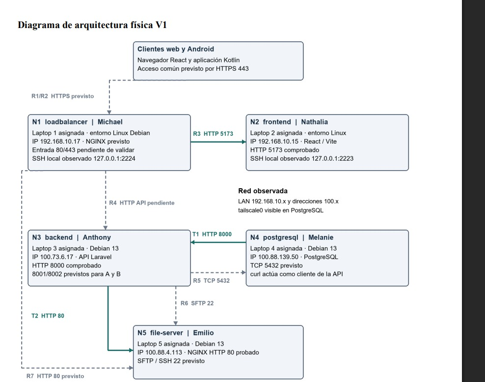

# Arquitectura Física V1 y Pruebas de Conectividad del Proyecto Integrador

> Transcripción completa del PDF *Arquitectura Física V1 y Pruebas de Conectividad del Proyecto Integrador*. Archivo original en esta misma carpeta. Las capturas de pantalla y las figuras 1 a 9 solo aparecen en el PDF; aquí se describen en el texto.

**Universidad Laica Eloy Alfaro de Manabí**
Facultad Ciencias de la Vida y Tecnología · Carrera: Ing. Software

- **Tema:** Nexocommerce
- **Autores:** Cardenas Ávila Emilio Sleimen · Michael Agustin Intriago Benitez · Anthony Axel Mejia Ordoñez · Melanie Dennise Perez Posligua · Nathalia Aracely Angulo Medranda
- **Docente:** Ing. Junior Zamora
- **Asignatura:** Integración e Implementación de Software
- **Periodo:** 2026 - "A"
- **Fecha de entrega:** 29/09/2026

---

## Descripción y alcance de la práctica

NexoCommerce es el proyecto de comercio electrónico para Aesca, emprendimiento de repostería, detalles y sublimación de Montecristi. La arquitectura distribuye la entrada al sistema, la interfaz web, la API, la base de datos y los archivos en cinco nodos con responsabilidades distintas.

En esta primera versión se identificaron direcciones IP de los cinco nodos, se obtuvieron respuestas ICMP entre backend y base de datos y entre base de datos y archivos, y se accedió por HTTP al frontend, a la API y al servidor de archivos desde otros nodos. Estas pruebas validan comunicaciones iniciales; la integración completa, el balanceo y el acceso remoto a PostgreSQL requieren verificaciones adicionales.

### Objetivo

Representar la distribución física prevista y comprobar las comunicaciones de los nodos mediante identificación de red, pruebas ping y solicitudes a servicios remotos, relacionando cada resultado con la arquitectura lógica V1.

## Distribución y entorno de ejecución

Se conserva la asignación de cinco laptops definida en el proyecto: Michael administra la entrada NGINX, Nathalia el frontend, Anthony el backend, Melanie la base de datos y Emilio el servidor de archivos. Las terminales identifican los sistemas como `loadbalancer`, `frontend`, `backend`, `postgresql` y `file-server`. La asignación representa la distribución de responsabilidades; las capturas no identifican el hardware anfitrión de cada entorno.

La práctica muestra entornos Linux y sesiones SSH con reenvío local de puertos. Debian 13 aparece en las consolas de backend, base de datos, balanceador y archivos. En frontend se observa Linux, sin identificación explícita de la versión. El uso de Debian es una variación respecto de Ubuntu Server previsto para archivos.

### Red empleada

El frontend y el balanceador utilizan `192.168.10.15` y `192.168.10.17`. Backend, base de datos y archivos utilizan `100.73.6.17`, `100.88.139.50` y `100.88.4.113` en las pruebas remotas. La interfaz `tailscale0` se observa en PostgreSQL. La red de ensayo combina direcciones de LAN y una red virtual; no se documenta todavía una única LAN por switch con los cinco equipos.

## Identificación de los nodos

| Nodo y equipo asignado | Sistema y responsabilidad | IP de prueba | Servicio y transporte |
|---|---|---|---|
| **N1** Laptop 1 · Michael · `loadbalancer` | Debian 13 · entrada y balanceo, NGINX previstos | 192.168.10.17 | HTTP 80 / HTTPS 443 previstos · SSH local 2224 observado |
| **N2** Laptop 2 · Nathalia · `frontend` | Linux · publicación de React mediante Vite | 192.168.10.15 | HTTP / TCP 5173 comprobado · SSH local 2223 observado |
| **N3** Laptop 3 · Anthony · `backend` | Debian 13 · API Laravel y reglas de negocio | 100.73.6.17 | HTTP / TCP 8000 comprobado · 8001 y 8002 previstos |
| **N4** Laptop 4 · Melanie · `postgresql` | Debian 13 · persistencia PostgreSQL | 100.88.139.50 | SQL / TCP 5432 previsto · pgAdmin visible |
| **N5** Laptop 5 · Emilio · `file-server` | Debian 13 · archivos y publicación NGINX | 100.88.4.113 | HTTP / TCP 80 comprobado · SFTP / SSH 22 previsto |

### Interpretación de puertos

Los puertos 5173, 8000 y 80 se respaldan con solicitudes curl y respuestas del servicio. El puerto 80 del servidor de archivos es el predeterminado de la URL HTTP sin puerto explícito. No se muestran listados de sockets ni estados de servicio que permitan confirmar todas las interfaces de escucha.

Las sesiones SSH muestran `127.0.0.1` con puertos locales 2222, 2223 y 2224. Estos valores corresponden al extremo local utilizado para acceder al entorno y no se deben presentar como puertos SSH publicados en las IP de los nodos. El destino interno 22 y las reglas de reenvío necesitan su propia comprobación.

### Responsabilidades de los clientes

El navegador ejecutará React y el cliente Android consumirá la API compartida. En esta práctica curl cumple el papel de cliente HTTP desde el nodo PostgreSQL. No se acredita todavía el flujo completo desde la interfaz React o desde Android, ni el acceso de los clientes por un punto NGINX común.

## Diagrama de arquitectura física V1

Línea continua verde: acceso HTTP probado. Línea discontinua gris: comunicación prevista que requiere validación. T1 y T2 son pruebas técnicas; R1 a R7 conservan la relación con el diseño lógico. Las respuestas regresan al solicitante. Las pruebas ICMP se detallan en la matriz siguiente.

La distribución de laptops corresponde al diseño del proyecto. Las IP y los accesos continuos corresponden a las capturas. La unión entre la LAN y la red virtual, el switch físico, los anfitriones y la ruta NGINX hacia todos los servicios deben completarse en la siguiente validación.

## Comunicaciones y comportamiento ante fallos

| Ruta | Medio y evidencia | Si el destino no está disponible |
|---|---|---|
| **R1 / R2** · Web o Android → N1 | HTTPS 443 previsto. Sin prueba del cliente por NGINX. | Los clientes no pueden acceder por la entrada común. |
| **R3** · N1 → N2 | HTTP 5173. Figura 7: HTML de Vite / React. | No se obtiene la interfaz web; debe registrarse el error de upstream. |
| **R4** · N1 → N3 | HTTP 8001/8002 del diseño; 8000 observado en T1. Balanceo sin probar. | La API queda inaccesible por NGINX si no hay una instancia disponible. |
| **R5** · N3 → N4 | SQL / TCP 5432 previsto. Figura 1: prueba ICMP, no SQL. | No se deben confirmar operaciones que requieren persistencia. |
| **R6** · N3 → N5 | SFTP / SSH 22 previsto; no se demuestra transferencia. | Las cargas y descargas privadas deberán devolver un error controlado. |
| **R7** · N1 → N5 | HTTP 80, ruta `/storage/` prevista. Sin solicitud desde N1. | Los archivos públicos no se sirven por la entrada común. |
| **T1** · N4 → N3 | HTTP 8000. Figura 9: JSON de estado de API. | curl no obtiene la respuesta de disponibilidad. |
| **T2** · N3 → N5 | HTTP 80. Figura 8: página de NGINX. | No se obtiene la página del servidor de archivos. |
| **T3** · N4 → N5 | ICMP. Figura 2: respuestas ping. Prueba auxiliar. | Se debe revisar ruta y filtrado ICMP; no basta para concluir caída del servicio. |

Los comportamientos ante fallos describen lo que debe manejar el sistema; no son resultados de pruebas de caída. ICMP no utiliza puertos TCP o UDP. Una respuesta ping verifica alcance IP, mientras que curl permite comprobar una respuesta de aplicación.

## Evidencias de configuración de red

**Direcciones del backend.** Prueba: `hostname -I` en backend. Resultado: aparecen `10.0.2.15` y `100.73.6.17`, además de IPv6. Se selecciona `100.73.6.17` porque es la dirección usada para consumir la API desde PostgreSQL en la figura 9.

**Direcciones de PostgreSQL.** Prueba: `hostname -I` en postgresql. Resultado: se observan `10.0.2.15` y `100.88.139.50`. Esta última coincide con el destino del ping desde backend y con la interfaz `tailscale0` visible en la figura 5.

**Direcciones del frontend.** Prueba: `hostname -I` en frontend. Resultado: se muestran `10.0.2.17`, `10.0.2.15` y `192.168.10.15`. Se utiliza `192.168.10.15` para el servicio web, porque el balanceador obtiene su contenido por el puerto 5173.

### 5.1 Red de archivos y balanceador

**Direcciones del servidor de archivos.** Prueba: `hostname -I` en file-server. Resultado: se observan `10.0.2.15` y `100.88.4.113`. La dirección `100.88.4.113` recibe ping desde PostgreSQL y una solicitud HTTP desde backend.

**Direcciones del balanceador.** Prueba: `hostname -I` en loadbalancer. Resultado: aparecen `10.0.2.15` y `192.168.10.17`. Esta salida identifica `192.168.10.17` como dirección del balanceador; por ello el ping de la figura 6 no demuestra acceso al frontend.

### Criterio de selección de la IP

Para cada conexión se emplea la IP alcanzable desde el nodo origen. Las direcciones `127.0.0.1` de las sesiones SSH son locales al equipo que ejecuta el comando. Del mismo modo, `localhost` en una solicitud HTTP apuntaría al propio cliente y no al servidor remoto.

Las cinco salidas `hostname -I` permiten identificar direcciones. Para completar la descripción de red se debe registrar `ip addr` e `ip route` en cada nodo, asociando interfaz, máscara, puerta de enlace y tipo de conexión con el anfitrión correspondiente.

## Conectividad IP entre nodos

**Ping del backend a PostgreSQL.** Origen: backend, identificado con `100.73.6.17`. Destino: `100.88.139.50`. Resultado: se observan respuestas ICMP consecutivas con TTL 64; existe alcance IP hacia PostgreSQL. La captura no incluye el resumen final y no demuestra acceso SQL al puerto 5432.

**Ping de PostgreSQL al servidor de archivos.** Origen: postgresql, identificado con `100.88.139.50`. Destino: `100.88.4.113`. Resultado: se observan cuatro respuestas ICMP con TTL 64. La prueba acredita conectividad entre estos nodos; no confirma por sí sola el servicio HTTP ni SFTP.

## Pruebas ping de alcance local

**Ping ejecutado desde frontend.** Origen: frontend. Destino: `10.0.2.15`.

**Ping del servidor de archivos a su propia IP.** Origen: file-server. Destino: `100.88.4.113`, que corresponde al mismo nodo. Resultado: 4 enviados, 4 recibidos y 0 % de pérdida. Comprueba respuesta local, pero no comunicación entre equipos.

**Ping del balanceador a su propia IP.** Origen: loadbalancer. Destino: `192.168.10.17`, identificado como el propio balanceador. Resultado: hay respuestas; la captura está rotulada como acceso a frontend, pero la IP del frontend es `192.168.10.15`. Se requiere repetir la prueba con ese destino.

## Acceso a servicios desde otros nodos

**Servicio web consultado desde el balanceador.** Prueba: `curl 192.168.10.15:5173` desde loadbalancer. Resultado: devuelve HTML con referencias a Vite, React y `/src/main.tsx`. Demuestra acceso HTTP al frontend; no acredita todavía renderizado en navegador ni consumo de la API.

**NGINX consultado desde el backend.** Prueba: `curl 100.88.4.113` desde backend. Resultado: devuelve la página "Welcome to nginx!" por HTTP 80. El servicio responde desde otro nodo; la página de bienvenida no demuestra carga de archivos, SFTP ni publicación de `/storage/`.

## Consumo de la API y acceso a datos

**Cliente curl desde PostgreSQL hacia backend.** Prueba: `curl 100.73.6.17:8000` desde postgresql. Resultado: JSON con `success=true`, servicio "NexoCommerce REST API", versión v1 y estado operativo. Comprueba una respuesta de la API desde otro nodo, sin validar aún las operaciones de negocio.

La solicitud usa la raíz del servicio y el puerto 8000. No muestra `/api/v1`, código de estado HTTP ni autenticación. Por ello se interpreta como una prueba inicial de disponibilidad de API; no como validación de pedidos, permisos o balanceo entre instancias.

**Base de datos NexoCommerce visible en pgAdmin.** Prueba: consulta del panel de pgAdmin 4. Resultado: la base NexoCommerce aparece en el árbol del servidor `localhost` y se visualizan sus paneles. No se muestra la IP de conexión ni una consulta SQL desde backend, por lo que no acredita todavía la ruta remota R5.

## Servidores Linux y acceso SSH

**Sesiones SSH y configuración de PostgreSQL.** Prueba: sesiones SSH mediante `127.0.0.1` y puertos locales 2222, 2223 y 2224. Resultado: se observan prompts de los nodos y Debian en las consolas; `ip addr` muestra `100.88.139.50/32` en `tailscale0`. Hay acceso a las sesiones, pero no se identifica una conexión desde otra laptop a la IP remota.

## Conclusión

La primera versión demuestra identificación de red, conectividad IP entre nodos seleccionados y respuestas HTTP de tres servicios: frontend, API y NGINX de archivos. Se confirma así una base funcional para avanzar en la integración distribuida de NexoCommerce.
